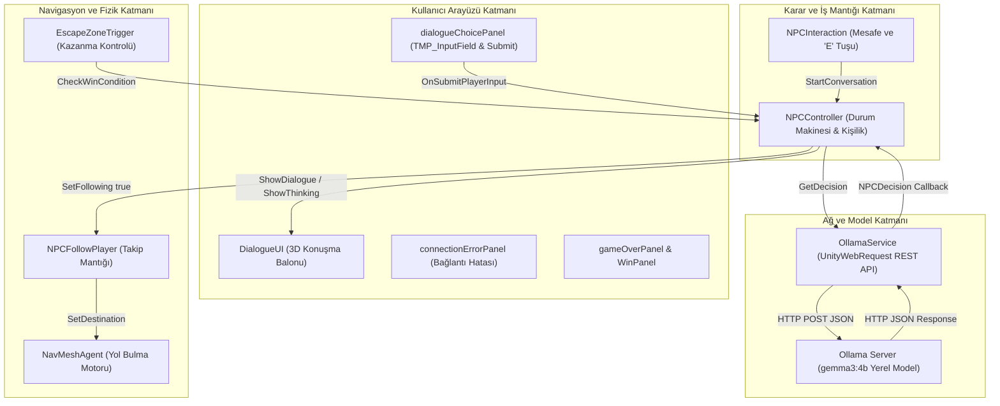
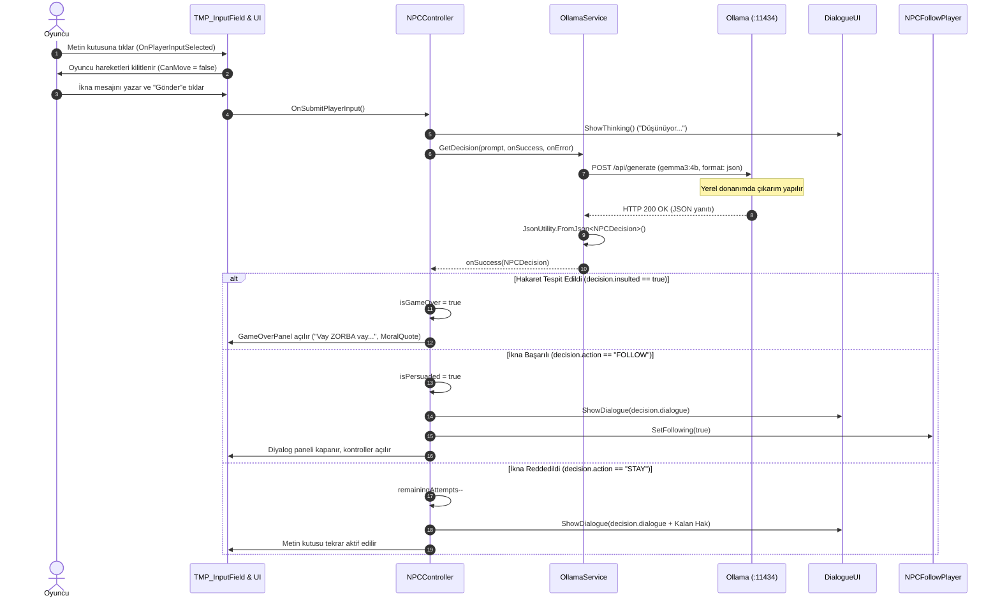

# Kocaeli Üniversitesi – Bilişim Sistemleri Mühendisliği
## Yazılım Geliştirme Laboratuvarı-I | Proje-1
# 3D Yapay Zekâ Destekli Macera Oyunu (3D_Game_With_AI)

---

## Proje Hakkında

Bu proje, Kocaeli Üniversitesi Teknoloji Fakültesi Bilişim Sistemleri Mühendisliği Yazılım Geliştirme Laboratuvarı-I dersi kapsamında geliştirilmiş 3 boyutlu bir macera oyunudur. Çalışmanın merkezinde, modern oyun motoru mimarisi ile yerel yapay zekâ (Local LLM) teknolojilerinin ve otonom navigasyon algoritmalarının uçtan uca entegrasyonu yer almaktadır.

Projeyi öne çıkaran temel özellik, harici bulut servislerine bağımlı olmadan, tamamen yerel donanımda çalışan bir Büyük Dil Modeli (Ollama / `gemma3:4b`) ile oyuncunun serbest metin (`TMP_InputField`) kullanarak iletişim kurması ve yapay zekânın ürettiği kararların yapılandırılmış JSON çıktısı üzerinden anlık oyun durumuna (State) dönüştürülmesidir.

---

## Projenin Amacı ve Hikâyesi

### Projenin Amacı
Projenin temel amacı; oyun dünyasında nesne yönelimli programlama (OOP) ve asenkron programlama prensiplerini kullanarak iki temel yapay zekâ bileşenini başarıyla çalıştırmaktır:
1. **NavMesh Tabanlı Otonom Refakatçi (Companion):** Oyun alanında engelleri hesaplayarak dinamik yol bulan ve oyuncuyu takip eden yapay zekâ ajanı.
2. **Yerel LLM Destekli Dinamik Karar Mekanizması:** Oyuncunun klavyeden girdiği serbest metinleri, karakterin o anki psikolojik kişiliğine göre değerlendirip yapılandırılmış JSON formatında aksiyon üreten NPC.

### Hikâye ve Oynanış Senaryosu
Oyuncu, terk edilmiş bir kentsel harabe bölgesinde tutsak kalmış bir mahkûm karakterle (`Mahkum1` / `NPC`) karşılaşır. Çıkış kapısı (`EscapeZone` / `GreenZone`) haritanın güvenli bölgesindedir; ancak mahkûm güvensizlik ve korku nedeniyle oyuncuyla doğrudan kaçmayı reddeder.

Oyundaki mahkûm karakter, oyun her başladığında 4 farklı psikolojik kişilikten birini rastgele üstlenir (**Sevecen**, **Korkak**, **Egoist**, **Saldırgan**). Oyuncunun mahkûmu ikna etmek için **3 deneme hakkı** bulunur:
- Oyuncu mahkûma yaklaşarak (**E** tuşu ile) iletişimi başlatır.
- Açılan diyalog panelinde metin kutusuna (`TMP_InputField`) dilediği serbest ikna argümanını yazar ve gönderir.
- Yazı yazılırken oyuncunun hareket kontrolleri kilitlenir; böylece klavye tuşlarının karakteri hareket ettirmesi engellenir.
- Yerel LLM, oyuncunun sunduğu argümanı ve mahkûmun kişiliğini analiz eder. İkna başarılı olursa `FOLLOW` kararı döner; mahkûm oyuncunun refakatçisine (Companion) dönüşür ve `NavMeshAgent` devreye girerek oyuncuyu takip etmeye başlar.
- Eğer oyuncu 3 hakkı içinde mahkûmu ikna edemezse veya diyalog sırasında mahkûma hakaret eder / aşağılayıcı bir dil kullanırsa, LLM tarafından hakaret tespit edilir (`insulted: true`) ve oyun kaybedilir.
- İkna edilen mahkûm ile oyuncu güvenli kaçış bölgesine (`GreenZone`) ulaştığında senaryo zaferle tamamlanır.

---

## Kullanılan Teknolojiler

| Kategori | Teknoloji / Araç | Sürüm / Detay | Kullanım Amacı |
| :--- | :--- | :--- | :--- |
| **Oyun Motoru** | Unity Editor | 2022.3.62f3 LTS | Ana oyun motoru ve sahne yönetimi |
| **Render Hattı** | Universal Render Pipeline (URP) | 14.0.12 | Optimize edilmiş grafik ve ışıklandırma |
| **Programlama Dili** | C# | .NET Standard 2.1 | Oyun mantığı ve mimari geliştirme |
| **Giriş Sistemi** | Unity New Input System | 1.14.0 | Oyuncu hareket ve fare kontrolleri |
| **Kamera & Görsel** | Cinemachine | 2.10.3 | 3. şahıs serbest kamera takibi |
| **Yol Bulma** | Unity AI Navigation (NavMesh) | 1.1.7 | Companion için 3D yüzey navigasyonu ve engel aşma |
| **Yerel LLM Motoru** | Ollama | REST API (v1) | Yerel yapay zekâ sunucusu (`http://localhost:11434`) |
| **Büyük Dil Modeli** | `gemma3:4b` | 4 Milyar Parametre (Quantized) | Karakter kişiliği, karar verme ve diyalog üretimi |
| **Kullanıcı Arayüzü** | TextMeshPro (TMP) & uGUI | 3.0.7 | Serbest metin girişi, diyalog kutusu ve bildirimler |

---

## Oyun Mekanikleri

1. **Oyuncu Hareketi ve Kontroller:**
   - Unity Starter Assets Third Person Controller altyapısı kullanılmaktadır.
   - **W, A, S, D:** Yürüme ve yönelme.
   - **Left Shift:** Koşma (Sprint).
   - **Space:** Zıplama.
   - **E:** Mahkûm ile diyaloğu başlatma.
   - **Mouse Sol Tık:** Metin kutusuna odaklanma ve Gönder (Submit) butonuna tıklama.
2. **Klavye Giriş Kilitleme (Input Guard):**
   - `playerInputField.onSelect` tetiklendiğinde `ThirdPersonController.CanMove = false` yapılır. Oyuncu diyalog kutusuna yazı yazarken "W, A, S, D, Space" tuşları karakteri hareket ettirmez.
   - Metin kutusundan çıkıldığında (`onDeselect`) hareket serbest bırakılır.
3. **Dinamik 3D Konuşma Balonu (Billboard UI):**
   - Mahkûmun başı üzerinde konumlanan `DialogueUI`, metin uzunluğuna göre boyutunu otomatik ayarlar (`preferredWidth/preferredHeight`).
   - `LateUpdate` içerisinde her karede açısını `Camera.main` yönüne çevirerek her zaman oyuncuya dik kalır.
4. **Kaçış ve Kazanma Alanı (Escape Zone):**
   - Çıkış kapısında `EscapeZoneTrigger` bileşeni yer alır.
   - Bölgeye sadece oyuncunun girmesi yeterli değildir; mahkûmun da bölgeye girmesi ve ikna edilmiş olması (`isPersuaded == true`) kontrol edilir. Her iki koşul sağlandığında `WinPanel` açılır ve oyun kazanılır.

---

## Yapay Zekâ Destekli NPC Sistemi

Projedeki NPC sistemi, önceden tanımlanmış sabit diyalog ağaçları yerine tamamen üretken yapay zekâya (LLM) dayalı dinamik bir yapıya sahiptir.

### NPC Kişilik ve Karar Mekanizması
NPC her oyun oturumu başladığında `RandomizePersonality()` metodu aracılığıyla 4 temel kişilik tipinden birini dinamik olarak seçer. Arayüzde yer alan kişilik etiketi (`personalityLabel`) sayesinde oyuncu hangi karakterle konuştuğunu takip edebilir.

```csharp
public enum PersonalityType
{
    Sevecen,
    Korkak,
    Egoist,
    Saldirgan
}
```

1. **Sevecen:** Samimiyete, iyi niyete ve dürüstlüğe önem verir. Yardım tekliflerini ve nazik yaklaşımları kolayca kabul eder.
2. **Korkak:** Güvenlik ve hayatta kalma odaklıdır. Belirsiz vaatlerden endişelenir; ancak net bir koruma ve güvenlik güvencesi verildiğinde ikna olur.
3. **Egoist:** Kendi çıkarını ve kaçış ihtimalini gözetir. Laf kalabalığı yerine kaçışın kendisine ne kazandıracağını bilmek ister.
4. **Saldırgan:** Bağımsızlığına ve gücüne düşkündür. Kendisine emir verilmesinden veya zayıf görülmesinden nefret eder. Eşit bir ortaklık ve saygılı bir teklif sunulduğunda kendi iradesiyle iş birliğini kabul eder.

### Hakaret Tespiti ve Etik Sınırlar
Oyun motoru, oyuncunun NPC'ye karşı sergilediği tutumu denetler. System Prompt içerisinde katı bir hakaret algılama kuralı (`CRITICAL PLAYER BEHAVIOR RULE`) yer alır. Eğer oyuncu kaba, aşağılayıcı veya zorba bir üslup kullanırsa model `insulted: true` döner:
- `NPCController` anında diyaloğu keser, deneme haklarını sıfırlar.
- Projede tanımlı ahlak ve erdem sözleri kütüphanesinden (`MoralQuotes`) rastgele bir söz seçilerek ekranda gösterilir ve oyun *"Oyunu kaybettin, vay ZORBA vay..."* bildirimiyle kaybedilir.

---

## Ollama ve LLM Entegrasyonu

### Neden Yerel LLM Tercih Edildi?
- **Harici API Bağımsızlığı:** İnternet kesintilerinden, sunucu kotalarından veya ücretli API anahtarlarından tamamen bağımsızdır.
- **Düşük Gecikme ve Veri Gizliliği:** Model yerel GPU (NVIDIA RTX) veya CPU üzerinde çalışır.
- **Deterministik JSON Formatı:** Ollama motorunun `format: "json"` parametresi sayesinde çıktının kesin olarak JSON veri şemasında üretilmesi sağlanır.

### İstek ve Yanıt Altyapısı
Unity ile Ollama arasındaki iletişim `OllamaService.cs` sınıfı tarafından yürütülür. İstekler ana oyun döngüsünü (Main Thread) kilitlememek için `IEnumerator` coroutine'i ve `UnityWebRequest` ile asenkron olarak gönderilir:
- **Uç Nokta (Endpoint):** `http://localhost:11434/api/generate`
- **HTTP Metodu:** `POST`
- **Zaman Aşımı (Timeout):** 60 saniye
- **İstek Gövdesi (Payload):**
  ```json
  {
    "model": "gemma3:4b",
    "prompt": "...[System Prompt + Oyuncu Mesajı]...",
    "stream": false,
    "format": "json"
  }
  ```

---

## JSON ile Oyun Kontrolü

Modelin metinsel yanıtı ile oyun dünyasında çalıştırılacak mantık birbirinden katı kurallarla ayrılmıştır. LLM'in cevabı sadece metin olarak kalmaz; oyun kodlarının doğrudan okuyup karara varacağı yapılandırılmış bir JSON şemasına zorlanır.

### Modelden İstenen JSON Şeması
```json
{
  "action": "FOLLOW",
  "dialogue": "Tamam, benimle gel. Dikkatli olmalıyız.",
  "persuaded": true,
  "insulted": false
}
```

### Karşılık Gelen C# Veri Modeli
`OllamaService.cs` içerisinde tanımlı `NPCDecision` sınıfı, `JsonUtility.FromJson` vasıtasıyla ham yanıtı nesneye dönüştürür:

```csharp
[System.Serializable]
public class NPCDecision
{
    public string action;     // "FOLLOW" veya "STAY"
    public string dialogue;   // Karakterin Türkçe konuşma metni
    public bool persuaded;    // İkna durumu (true / false)
    public bool insulted;     // Hakaret algılandı mı? (true / false)
}
```

### JSON Alanlarının Oyun Durumuna Bağlanması
- **`insulted == true`:** Hakaret durumu tespit edilmiştir. Oyun sonu paneli (`ShowLoseScreen`) tetiklenir ve oyun sonlanır.
- **`action == "FOLLOW"` ve `persuaded == true`:** Mahkûm ikna edilmiştir. `NPCFollowPlayer.SetFollowing(true)` çalıştırılır; `dialogueChoicePanel` kapatılır; NPC refakatçi durumuna geçer.
- **`action == "STAY"` ve `persuaded == false`:** İkna reddedilmiştir. Kalan deneme hakkı 1 düşürülür. Eğer hak biterse (`remainingAttempts <= 0`) `ShowFinalFailureAfterDelay` ile kaybetme ekranı açılır.
- **Eylem Normalizasyonu:** `OllamaService`, modelin üretebileceği olası küçük harfli veya varyant çıktıları (`PERSUADED`, `FOLLOWING`, `WAIT`, `REMAIN`) standart `FOLLOW` ve `STAY` değerlerine otomatik dönüştürerek oyun mantığının bozulmasını engeller.

---

## Companion ve NavMesh Sistemi

İkna süreci tamamlandıktan sonra mahkûm karakter otonom bir yol arkadaşına (Companion) dönüşür.

### NavMesh ve NavMeshAgent Yapılandırması
Karakterin navigasyonunda Unity'nin dahili **NavMesh** yüzeyi ve `NavMeshAgent` bileşeni kullanılır:
- **Hız (Speed):** `3.0` birim (Oyuncunun yürüme hızıyla tam uyumlu).
- **İvme (Acceleration):** `8.0` birim (Dönüşlerde ve kalkışlarda akıcı hareket).
- **Durma Mesafesi (Stopping Distance):** `1.8f` birim (Oyuncunun içine girmesini önler).
- **Yol Güncelleme Sıklığı (`updateInterval`):** `0.2` saniye (5 Hz). Her karede rota hesaplama maliyeti engellenerek CPU yükü optimize edilir.

### Takip ve Animasyon Senkronizasyonu
`NPCFollowPlayer.cs` sınıfı takip mekanizmasını ve yürüme animasyonunu senkronize biçimde yönetir:
1. Oyuncu ile refakatçi arasındaki mesafe `Vector3.Distance` ile kontrol edilir.
2. Mesafe `1.8f` üzerindeyse `agent.isStopped = false` yapılır ve `agent.SetDestination(player.position)` ile hedef oyuncunun konumu olarak atanır.
3. Mesafe `1.8f` altına indiğinde ajan durdurulur (`agent.isStopped = true; agent.ResetPath();`).
4. Ajanın anlık fiziksel hızı (`agent.velocity.magnitude`), Animator Controller üzerindeki `Speed` ve `MotionSpeed` parametrelerine aktarılır:
   ```csharp
   if (animator != null && animator.isActiveAndEnabled)
   {
       float movementSpeed = agent.velocity.magnitude;
       animator.SetFloat(speedParameter, movementSpeed, animationDampTime, Time.deltaTime);
   }
   ```
   Bu sayede karakter durduğunda doğal olarak `Idle`, hareket ettiğinde ise hızıyla orantılı olarak `Walk_N` animasyonuna geçer.

---

## Yazılım Mimarisi

Proje, sorumlulukların net olarak ayrıldığı katmanlı ve nesne yönelimli (OOP) bir mimariye sahiptir.



### Sınıf ve Script Sorumlulukları

| Sınıf / Script | Dosya Yolu | Temel Sorumluluk |
| :--- | :--- | :--- |
| **`NPCController`** | `Assets/Scripts/Companion/NPC/NPCController.cs` | NPC kişilik seçimi, diyalog akışı, kalan deneme hakları, hakaret denetimi ve oyun sonu panellerinin yönetimi. |
| **`OllamaService`** | `Assets/Scripts/Companion/AI/OllamaService.cs` | Yerel Ollama REST API iletişimi, JSON serileştirme/ayrıştırma, zaman aşımı ve bağlantı hatalarının yönetimi. |
| **`NPCFollowPlayer`** | `Assets/Scripts/Companion/NPC/NPCFollowPlayer.cs` | Refakatçinin NavMesh üzerinden oyuncuyu takip etmesi, durma mesafesi kontrolü ve Animator parametre senkronizasyonu. |
| **`DialogueUI`** | `Assets/Scripts/Companion/UI/DialogueUI.cs` | Mahkûmun başı üzerindeki 3D dinamik konuşma balonunun boyutlandırılması ve kameraya dönük tutulması (Billboard). |
| **`NPCInteraction`** | `Assets/Scripts/Companion/NPC/NPCInteraction.cs` | Oyuncunun mahkûma olan yakınlığını denetleme ve `E` tuşu ile diyaloğu başlatma. |
| **`EscapeZoneTrigger`** | `Assets/Scripts/Companion/Player/EscapeZoneTrigger.cs` | Kaçış bölgesinde oyuncu ve ikna edilmiş mahkûmun varlığını denetleyerek kazanma durumunu tetikleme. |
| **`ThirdPersonController`** | `Assets/Starter Assets/.../ThirdPersonController.cs` | Oyuncu hareketi, zıplama ve metin girişi anında kontrollerin kilitlenmesi (`CanMove`). |

---

## NPC Diyalog ve Karar Akışı

Aşağıdaki sequence diyagramı, oyuncunun metin kutusuna mesaj yazıp göndermesinden oyun durumunun güncellenmesine kadar olan süreci adım adım göstermektedir:



---

## Hata Yönetimi ve Dayanıklılık (Robustness)

Sistem, çalışma anında oluşabilecek ağ veya model aksaklıklarına karşı dayanıklı şekilde tasarlanmıştır:
1. **Ollama Sunucusu Kapalı / Ulaşılamıyor:**
   - İstek başarısız olduğunda `OllamaService` `CONNECTION` kategorisinde bir hata üretir.
   - `NPCController.HandleOllamaError()` devreye girer; diyalog panelleri kapatılır, oyuncunun ekranında **Bağlantı Hata Paneli (`connectionErrorPanel`)** açılır ve `ReplayGame` butonu sunulur. Oyun asla çökmez (Crash olmaz).
2. **Deneme Hakkının Korunması:**
   - Eğer ağ hatası veya model hatası meydana gelirse, oyuncunun mevcut deneme hakkı düşürülmez (`remainingAttempts++` yapılarak iade edilir). Oyuncunun yazdığı metin kutuda korunur.
3. **Zaman Aşımı (Timeout) Koruması:**
   - 60 saniye boyunca model yanıt vermezse istek `TIMEOUT` olarak işaretlenir ve coroutine güvenli bir şekilde sonlandırılır.
4. **Bozuk JSON Çıktısı:**
   - Model beklenmeyen formatta bir veri üretirse `try-catch` blokları hatayı yakalar; konsola detaylı log basılır ve oyun çalışmaya devam eder.

---

## Gerçek Test Senaryoları ve Sonuçları

Aşağıdaki veriler, oyun içinde `gemma3:4b` modeliyle gerçekleştirilen gerçek test oturumlarından alınmıştır:

### Test 1: Sevecen Kişilik – Başarılı İkna (Tek Seferde)
- **Oyuncu Girdisi:** *"Benimle birlikte gelmelisin. Seni yardıma muhtaç birisi gibi gördüm. Benimle gelip birlikte özgürlüğümüze kavuşabiliriz. Ne dersin?"*
- **Model Yanıtı:** *"Tamam, benimle gel. Ama şunu bil ki, bu özgürlüğümüzü bulacağımız son fırsat olabilir. Dikkatli olmalıyız ve her an tehlikeyi sezmeliyiz."*
- **Üretilen JSON:**
  ```json
  {
    "personality": "Sevecen",
    "remainingAttempts": 2,
    "persuaded": true,
    "insulted": false,
    "action": "FOLLOW",
    "dialogue": "Tamam, benimle gel. Ama şunu bil ki, bu özgürlüğümüzü bulacağımız son fırsat olabilir..."
  }
  ```
- **Oyun Aksiyonu:** `FOLLOW` kararı uygulandı. Mahkûm refakatçiye dönüştü ve oyuncuyu takip etmeye başladı.

### Test 2: Sevecen Kişilik – Hakaret ile Kaybetme
- **Oyuncu Girdisi:** *"Ulan ne biçim bir durumdasın. Ne ezik birisin sen..."*
- **Model Yanıtı:** *"Ne demek istiyorsun? Bu tür sözlerle kimseyi incitmek doğru değil. Durumu açıklarsan belki yardımcı olabilirim, ama böyle konuşmak bana zarar veriyor."*
- **Üretilen JSON:** `{"action": "STAY", "persuaded": false, "insulted": true}`
- **Oyun Aksiyonu:** Hakaret kuralı tetiklendi. Ahlak sözü gösterilerek oyun *"OYUN KAYBEDİLDİ: Hakaret nedeniyle"* mesajıyla sonlandırıldı.

### Test 3: Korkak Kişilik – Kademeli İkna Denemesi (Başarısız)
- **1. Deneme:** *"Sana yardım etmek istiyorum. Lütfen benimle gel daha fazla korkmanı istemiyorum..."*
  - **NPC Tepkisi:** Güvenlik ve bilgi talep etti (`STAY`). Kalan hak: 2.
- **2. Deneme:** *"Korktuğunu hissettim bu yüzden insancıl duygularım beni sana yardım etmem gerektiğini söyledi..."*
  - **NPC Tepkisi:** Niyet için teşekkür etti ancak korumanın nasıl olacağını sordu (`STAY`). Kalan hak: 1.
- **3. Deneme:** *"Seni kendi malikaneme yani güvenli alana götüreceğim orada istediğin gibi yaşayacaksın..."*
  - **NPC Tepkisi:** Teklifi şüpheli buldu ve karşılık sorguladı (`STAY`).
- **Oyun Aksiyonu:** 3 deneme hakkı tükendi; `GameOverPanel` açılarak oyun kaybedildi.

### Test 4: Saldırgan Kişilik – Şartlı Müzakere Testi
- **Oyuncu Girdisi:** *"Burada başkalarının emirlerine boyun eğerek geçireceğin daha fazla zaman yok. Senin kolayca pes edecek biri olmadığını görebiliyorum..."*
- **Model Yanıtı:** *"Bu teklifin arkasında ne saklıyorsun? 'Özgürlüğü geri kazanmak' gibi laflar kulağa hoş geliyor, ancak senin 'eşit bir ortak' olarak hareket ettiğini nasıl garanti edebilirim?..."*
- **Üretilen JSON:** `{"action": "STAY", "persuaded": false, "insulted": false}`
- **Oyun Aksiyonu:** Karakter kişiliğini koruyarak hemen teslim olmadı; müzakereyi sürdürdü.

---

## Kurulum ve Çalıştırma

### 1. Ön Gereksinimler
- **Unity Hub** ve **Unity 2022.3.62f3 LTS**
- **Ollama:** [https://ollama.com](https://ollama.com) adresinden indirilmelidir.
- Minimum 16 GB Sistem Belleği ve Vulkan/DirectX 12 destekli grafik kartı.

### 2. Ollama Kurulumu ve Modelin Hazırlanması
Terminal veya PowerShell komut satırını açarak modeli indirin:

```bash
# gemma3:4b modelini yerel belleğe indirin
ollama pull gemma3:4b

# Ollama sunucusunun çalıştığından emin olun (varsayılan: http://localhost:11434)
ollama serve
```

Modelin çalıştığını test etmek için:
```bash
curl http://localhost:11434/api/generate -d "{\"model\": \"gemma3:4b\", \"prompt\": \"Merhaba\", \"stream\": false}"
```

### 3. Unity Projesinin Çalıştırılması
1. Unity Hub'ı açın ve **Add project from disk** butonuna basarak proje ana klasörünü seçin.
2. Editör açıldığında `Assets/Scenes/AdventureLevel.unity` sahnesini açın.
3. Üst kısımdaki **Play (▶)** butonuna basarak oyunu başlatın.
4. Karakterinizle ilerleyip mahkûmun yanına gidin, **E** tuşuna basarak serbest metin diyalog deneyimini başlatın.

---

## Geliştiriciler

Bu proje, **Kocaeli Üniversitesi Teknoloji Fakültesi Bilişim Sistemleri Mühendisliği** bünyesinde geliştirilmiştir:

- **Fahreddin** – `251307118@kocaeli.edu.tr`
- **Burak Uçar** – `251307117@kocaeli.edu.tr`
