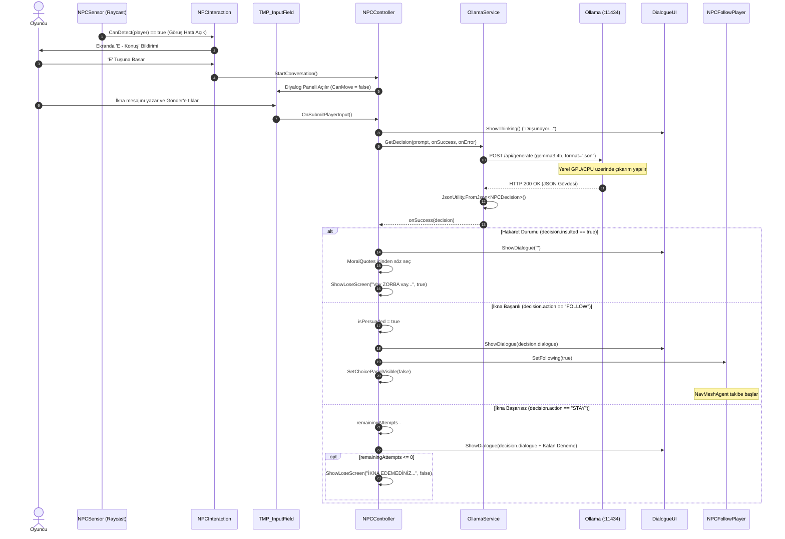
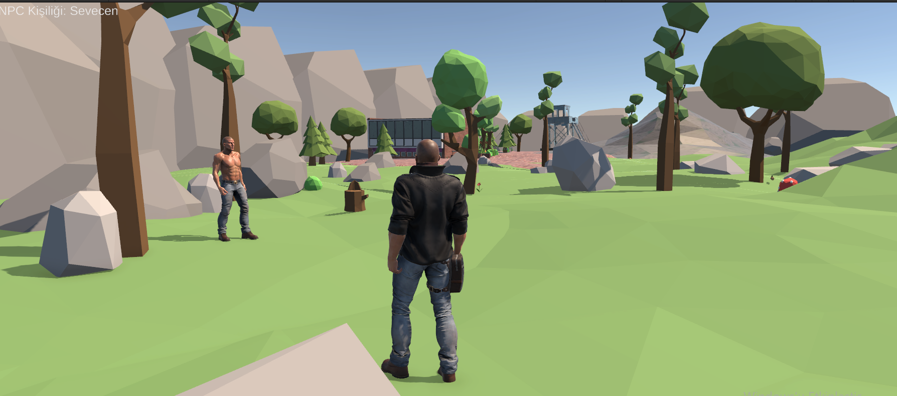
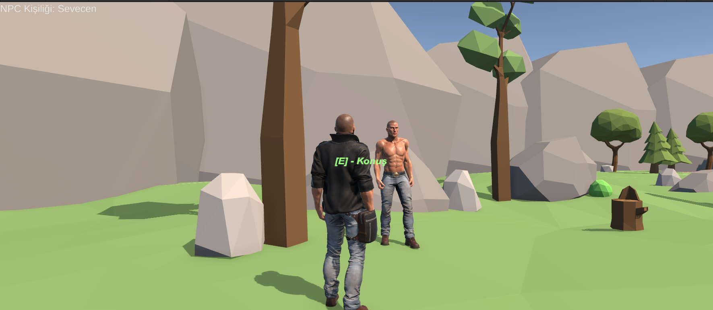
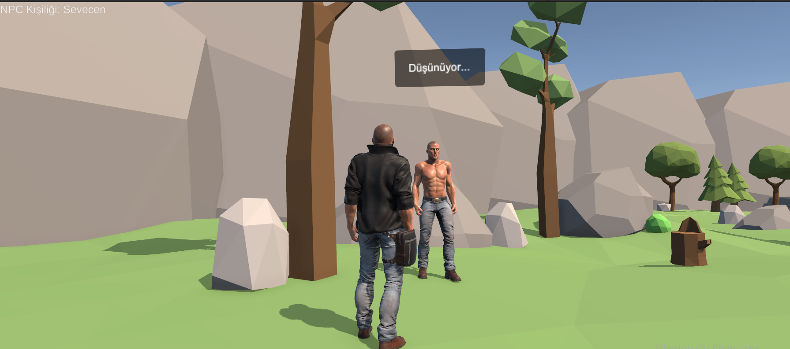
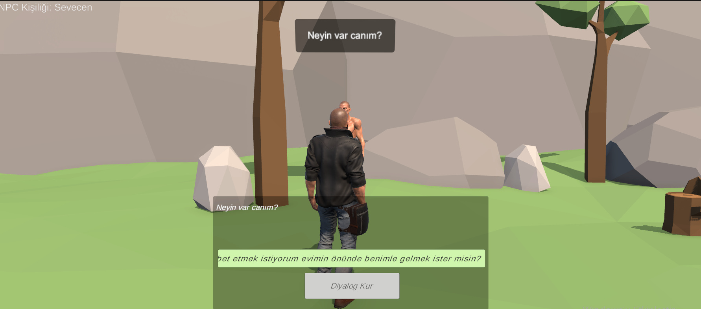
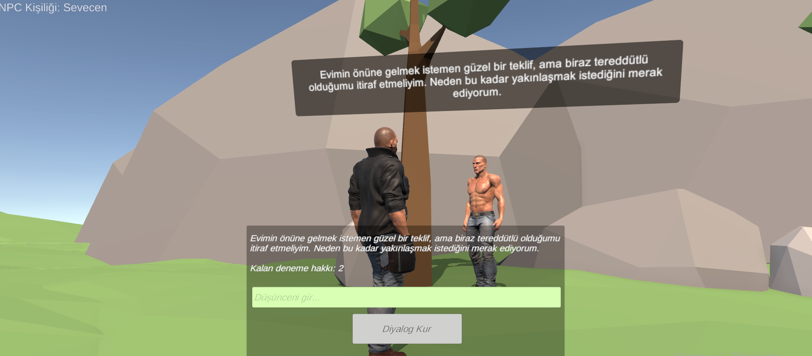
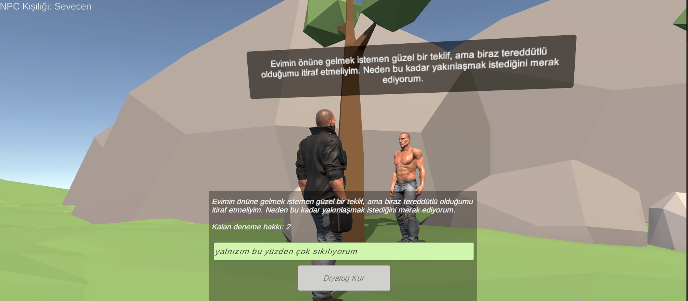
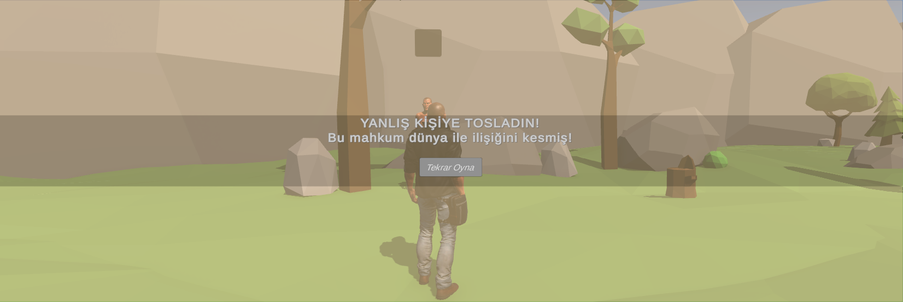
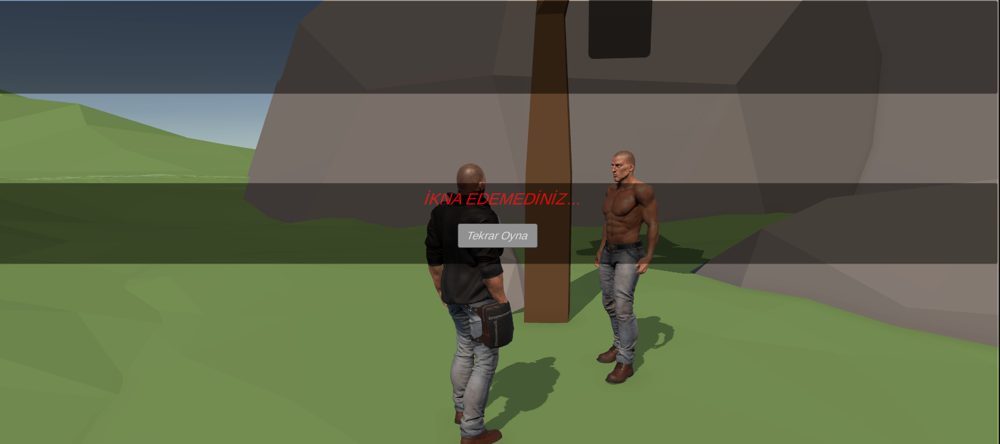
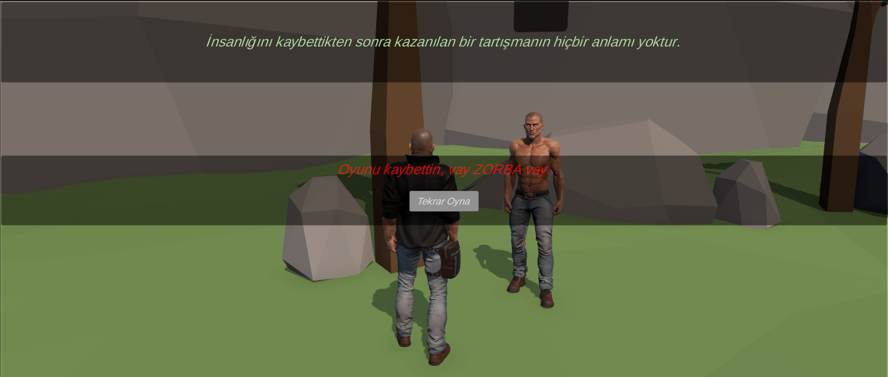

# Kocaeli Üniversitesi – Bilişim Sistemleri Mühendisliği
## Yazılım Geliştirme Laboratuvarı-I Dersi | Proje-1
# 3D Yapay Zekâ Destekli Macera Oyunu (3D_Game_With_AI)
 
---
 
## 1. Giriş
 
### 1.1 Proje Bilgileri
- **Proje Adı:** 3D Yapay Zekâ Destekli Macera Oyunu (`3D_Game_With_AI`)
- **Kurum:** Kocaeli Üniversitesi, Teknoloji Fakültesi, Bilişim Sistemleri Mühendisliği
- **Ders:** Yazılım Geliştirme Laboratuvarı-I (2026–2027 Güz Dönemi)
- **Tarih:** 6 Kasım 2026
- **Ekip Üyeleri:**
  - **Fahreddin** (Öğrenci No: `251307118`, E-posta: `251307118@kocaeli.edu.tr`)
  - **Burak Uçar** (Öğrenci No: `251307117`, E-posta: `251307117@kocaeli.edu.tr`)
 
### 1.2 Problem Tanımı ve Amaç
Klasik video oyunlarında NPC (Non-Player Character) diyalogları ve karar mekanizmaları çoğunlukla önceden yazılmış sabit durum ağaçlarına (hardcoded branch) veya statik seçim listelerine dayanmaktadır. Bu yaklaşım oyuncunun serbestçe kendini ifade edebilmesini engellemekte, öngörülebilir ve tekrara düşen bir oynanış doğurmaktadır.
 
Bu projenin amacı; modern bir oyun motoru (Unity 2022.3 LTS) üzerinde, harici bulut API'lerine bağımlı olmaksızın tamamen yerel donanımda çalışan bir Büyük Dil Modeli (Local LLM - Ollama / `gemma3:4b`) ile entegre, serbest metin tabanlı (`TMP_InputField`) dinamik bir NPC ikna mekanizması kurmaktır. Aynı zamanda modelin ürettiği yapılandırılmış JSON çıktısını ayrıştırarak, oyuncuyu harita boyunca otonom olarak takip eden `NavMesh` tabanlı ve fiziksel çevreyi ışınlarla algılayan `Raycast` sensörlü bir yapay zekâ refakatçisi (Companion) oluşturmak; böylece dil modeli, otonom yol bulma ve sensör algılama sistemlerini tek bir oynanış döngüsünde birleştirmektir.
 
### 1.3 Genel Oyun Senaryosu
Oyun, terk edilmiş bir kentsel harabe bölgesinde geçer:
1. **Karşılaşma:** Oyuncu üçüncü şahıs kontrolündeki karakteriyle (`PlayerArmatureK`) haritada ilerler ve parmaklıklar ardında tutsak kalmış bir mahkûm NPC (`Mahkum1` / `NPC`) ile karşılaşır.
2. **Sensör Doğrulaması:** Mahkûm karakter üzerindeki `NPCSensor` bileşeni, fiziksel ışın atımlarıyla (`Physics.Raycast`) oyuncunun görüş alanında olup olmadığını ve aralarında bir engel bulunup bulunmadığını doğrular. Görüş hattı netleştiğinde etkileşim bildirimi ekranda belirir.
3. **Kişilik ve İkna Müzakeresi:** Mahkûm, oyun başında 4 farklı psikolojik mizaçtan birini (**Sevecen**, **Korkak**, **Egoist**, **Saldırgan**) rastgele üstlenir. Oyuncunun mahkûmu kendisiyle birlikte kaçmaya ikna etmek için **3 deneme hakkı** bulunur.
4. **Serbest Metin Girişi:** Oyuncu **E** tuşuyla diyaloğu başlatır; açılan arayüzde klavyeden istediği cümleyi serbestçe yazar. Oyuncu yazarken karakter hareket kontrolleri (`CanMove = false`) kilitlenir.
5. **Yapay Zekâ Kararı ve Rol Değişimi:** Yerel LLM, oyuncunun mesajını ve NPC mizacını analiz eder. Eğer teklif ikna edici bulunursa `FOLLOW` kararı verilir; mahkûm refakatçiye (Companion) dönüşerek `NavMeshAgent` ile oyuncuyu takip etmeye başlar.
6. **Hakaret ve Kaybetme:** Oyuncu mahkûma kaba veya aşağılayıcı ifadeler kullanırsa model bunu tespit eder (`insulted: true`), ahlak kütüphanesinden (`MoralQuotes`) bir söz gösterilerek oyun kaybedilir. 3 deneme hakkı tükenirse de ikna başarısızlığı nedeniyle oyun biter.
7. **Kaçış ve Zafer:** İkna edilen refakatçi ile oyuncu haritanın çıkışındaki güvenli bölgeye (`GreenZone` / `EscapeZone`) ulaştığında senaryo zaferle tamamlanır.
 
---
 
## 2. Otonom AI Kahraman (Companion) ve Sensör Sistemi
 
### 2.1 Hareket ve Yol Bulma Mekanizması
Projede `ML-Agents` takviyeli öğrenme paketi kullanılmamış; endüstri standardı olan **Unity AI Navigation (`com.unity.ai.navigation: 1.1.7`)** altyapısı ve sahneye fırınlanmış (baked) 3D **NavMesh** yüzeyi tercih edilmiştir.
 
Companion rolündeki mahkûm karakter, `NPCFollowPlayer.cs` sınıfı ve `NavMeshAgent` bileşeni üzerinden kontrol edilir:
- **Hız (Speed):** `3.0` birim (Oyuncunun normal yürüme hızıyla tam senkronize).
- **İvme (Acceleration):** `8.0` birim (Ani dur-kalklarda sarsıntıyı önleyen yumuşak ivmelenme).
- **Durma Mesafesi (Stopping Distance):** `1.8f` birim (Oyuncunun kişisel alanına çarpmadan arkasında durma eşiği).
- **Rota Güncelleme Periyodu (`updateInterval`):** `0.2` saniye (5 Hz). Her karede `SetDestination` çağrısının getireceği CPU A* yükünü önlemek için periyodik timer kullanılır.
 
### 2.2 Takip ve Animasyon Senkronizasyonu
Ajanın anlık fiziksel yer değiştirme büyüklüğü (`agent.velocity.magnitude`), Animator Controller üzerindeki `Speed` float parametresine ve çarpan görevi gören `MotionSpeed` parametresine aktarılır. Bu sayede ajan durduğunda `Idle`, yürüdüğünde hızıyla tam uyumlu `Walk_N` animasyonu oynatılır; ayak kayması (foot sliding) problemi engellenir.
 
### 2.3 Raycast Tabanlı Sensör ve Görüş Alanı Sistemi (`NPCSensor.cs`)
Projede, otonom ajanın çevresindeki engelleri ve hedef oyuncuyu algılayabilmesi amacıyla **`NPCSensor.cs`** sınıfı geliştirilmiş ve NPC nesnesine entegre edilmiştir.
 
```csharp
public class NPCSensor : MonoBehaviour
{
    [Header("Sensor Settings")]
    [SerializeField] private Transform sensorOrigin;
    [SerializeField] private float detectionDistance = 2.5f;
    [SerializeField] private LayerMask obstacleLayers = ~0;
 
    public bool HasObstacle { get; private set; }
    public float ObstacleDistance { get; private set; }
    public GameObject DetectedObject { get; private set; }
    ...
}
```
 
Sensör sistemi iki temel işlevi yerine getirir:
1. **Sürekli Çevresel Engel Algılama (`DetectObstacle`):**
   - Karakterin göğüs/baş hizasındaki referans noktasından (`sensorOrigin`), karakterin baktığı yöne (`transform.forward`) doğru `Physics.Raycast` fırlatılır.
   - Algılama mesafesi dahilinde (`detectionDistance = 2.5m`) bir engel bulunduğunda `HasObstacle = true`, `ObstacleDistance = _hit.distance` ve `DetectedObject = _hit.collider.gameObject` değerleri güncellenir.
   - Sahne ekranında (Scene View) görsel hata ayıklama için `Debug.DrawRay` kullanılır; yol açıkken **yeşil**, önünde engel varken **kırmızı** ışın çizilir.
2. **Görüş Hattı ve Hedef Algılama (`CanDetect(Transform target)`):**
   - Oyuncunun tam konumuna doğru yön vektörü hesaplanır: `(targetPoint - origin).normalized`.
   - Arada bir engel (duvar, parmaklık, nesne) olup olmadığı `Physics.Raycast` ile taranır.
   - Işın doğrudan oyuncunun collider'ına çarpıyorsa hedef algılanmış sayılır (`hit.transform == target`).
3. **`NPCInteraction.cs` ile Entegrasyon:**
   - Oyuncunun sadece NPC'ye yaklaşması (mesafe) yeterli değildir; `NPCInteraction.Update()` döngüsünde `npcSensor.CanDetect(player)` çağrılır.
   - Ajan oyuncuyu Raycast ile doğrudan gördüğünde ekranda "E - Konuş" etkileşim promptu aktifleşir ve diyaloğa izin verilir.
 
### 2.4 Companion Karar, Algılama ve Davranış Akış Şeması
 
```mermaid
flowchart TD
    A([Oyun Başlangıcı]) --> B[NPCSensor Devrede: Raycast ile Çevre Taraması]
    B --> C[NPC Pasif Durumda: isFollowing = false]
   
    C --> D{NPCSensor.CanDetect Player?<br/>Raycast Görüş Hattı Net mi?}
    D -- Hayır / Engel Var --> C
    D -- Evet: Oyuncu Algılandı --> E[Ekranda 'E - Konuş' Promptu Gösterilir]
   
    E --> F{Oyuncu 'E'ye Bastı mı?}
    F -- Evet --> G[Ollama Diyalog ve İkna Müzakeresi Başlar]
    F -- Hayır --> C
   
    G --> H{Ollama Kararı: FOLLOW?}
    H -- Hayır / İkna Başarısız --> C
    H -- Evet: İkna Başarılı --> I[SetFollowing true: isFollowing = true]
   
    I --> J[Timer Kontrolü: updateTimer >= 0.2s?]
    J -- Hayır --> J
    J -- Evet --> K[Mesafe Ölçümü: Vector3.Distance NPC, Player]
   
    K --> L{Mesafe <= 1.8f?}
    L -- Evet: Oyuncunun Yanında --> M[agent.isStopped = true<br/>agent.ResetPath()]
    M --> N[Animatör Hızı = 0: Idle Animasyonu]
   
    L -- Hayır: Oyuncu Uzakta --> O[agent.isStopped = false<br/>agent.SetDestination player.position]
    O --> P[Animatör Hızı = agent.velocity.magnitude: Walk Animasyonu]
   
    N --> R{EscapeZone Alanına Girildi mi?}
    P --> R
    R -- Evet + Oyuncu da Alanda --> S([OYUN KAZANILDI - WinPanel])
    R -- Hayır --> J
```
 
---
 
## 3. LLM Entegrasyonu
 
### 3.1 Yerel Model ve Ollama Mimarisi
- **Model:** `gemma3:4b` (Google Gemma 3 mimarisi, 4 milyar parametre, 4-bit quantize).
- **Sunucu:** Yerel REST API (`http://localhost:11434/api/generate`).
- **Neden Yerel LLM:** Harici API anahtarlarına ihtiyaç duymaması, veri gizliliği sunması, sıfır maliyetle sınırsız deneme imkânı tanıması ve `format: "json"` desteğiyle deterministik yapılandırılmış veri üretmesi.
 
### 3.2 Sistem Promptu Tasarımı
`NPCController.cs` içerisinde her istek için dinamik olarak inşa edilen sistem promptu, modele aşağıdaki görev ve kuralları yükler:
1. **Hakaret Algılama Önceliği (`CRITICAL PLAYER BEHAVIOR RULE`):** Oyuncu mesajında kişisel hakaret, aşağılama, küfür veya zorbalık varsa diğer değerlendirmeler göz ardı edilerek `insulted: true`, `action: "STAY"`, `persuaded: false` dönülmelidir.
2. **Kişilik Şablonları:**
   - *Sevecen:* Dürüstlüğe, samimiyete ve ortak kurtuluşa değer verir.
   - *Korkak:* Güvenlik ve net koruma vaatleriyle ikna olur; belirsizlikten kaçınır.
   - *Egoist:* Kendi menfaatini ve kaçış avantajını ön planda tutar.
   - *Saldırgan:* Bağımsızlığına düşkündür, boyun eğmez; eşit ortaklık ve saygılı teklifleri değerlendirir.
3. **Katı JSON Kuralı:** Yanıt yalnızca `action`, `dialogue`, `persuaded` ve `insulted` alanlarını içeren geçerli bir JSON olmalıdır. Markdown veya ek metin üretilmesi yasaktır.
 
### 3.3 JSON Şeması ve C# Sınıf Eşleşmesi
 
**Modelden Dönen JSON Örneği:**
```json
{
  "action": "FOLLOW",
  "dialogue": "Tamam, seninle geliyorum. Buradan bir an önce çıkalım.",
  "persuaded": true,
  "insulted": false
}
```
 
**`OllamaService.cs` İçerisindeki Veri Modeli:**
```csharp
[System.Serializable]
public class NPCDecision
{
    public string action;     // "FOLLOW" veya "STAY"
    public string dialogue;   // Mahkûmun Türkçe konuşma cümlesi
    public bool persuaded;    // İkna sonucu (true / false)
    public bool insulted;     // Hakaret algılandı mı? (true / false)
}
```
 
### 3.4 İstek / Yanıt ve Oyun Durumuna Aktarma Sıralama Diyagramı
 

 
---
 
## 4. Hata Yönetimi ve Dayanıklılık (Robustness)
 
Projede `OllamaService.cs` ve `NPCController.cs` sınıfları üzerinden çok katmanlı bir hata denetimi uygulanmıştır:
 
1. **Sunucu Erişilemezliği / Ollama Kapalı:**
   - `request.result != UnityWebRequest.Result.Success` durumu oluştuğunda hata `CONNECTION` kategorisine alınır.
   - `NPCController.HandleOllamaError()` metodu tetiklenir: Diyalog arayüzü kapatılır, ekranda özel olarak tasarlanmış **Bağlantı Hata Paneli (`connectionErrorPanel`)** açılır ve oyuncuya oyunu yeniden başlatabileceği bir `Retry` butonu sunulur. Oyun kesinlikle donmaz veya çökmez.
2. **Deneme Hakkının Korunması:**
   - Ağ hatası, sunucu çökmesi veya model hatası meydana geldiğinde, başarısız istek ikna denemesi sayılmaz (`remainingAttempts++` yapılarak harcanan hak anında iade edilir). Oyuncunun yazdığı metin kutuda saklanır.
3. **Zaman Aşımı (Timeout):**
   - Modelin donması veya aşırı yük altında kalması durumuna karşı `request.timeout = 60` saniye sınırı belirlenmiştir. Süre aşılırsa `TIMEOUT` hatası fırlatılarak coroutine sonlandırılır.
4. **Geçersiz / Bozuk JSON:**
   - Model çıktısı `try-catch` blokları ile `JsonUtility.FromJson` işleminden geçirilir. Ayrıştırma hatasında `onError` devreye girer.
5. **Eksik Alan Doğrulaması:**
   - Gelen JSON içerisinde `action` veya `dialogue` alanları boş ise yanıt geçersiz sayılarak reddedilir.
6. **Eylem Normalizasyonu:**
   - Modelin `FOLLOW` yerine `following`, `STAY` yerine `wait` veya `remain` döndürmesi ihtimaline karşı string temizleme ve normalizasyon filtreleri uygulanmıştır.
 
---
 
## 5. Testler ve Sonuçlar
 
### 5.1 LLM Diyalog Test Senaryoları (Assets/Test.md Gerçek Kayıtları)
 
Proje kapsamında `gemma3:4b` yerel modeliyle gerçekleştirilen ve `Assets/Test.md` dosyasında kayıt altına alınan 5 temel test senaryosu aşağıda özetlenmiştir:
 
| Senaryo No | Karakter Mizacı | Oyuncu Girdisi | Modelin Ürettiği Karar ve JSON | Tetiklenen Oyun Aksiyonu | Test Sonucu |
| :---: | :--- | :--- | :--- | :--- | :---: |
| **TEST-1** | **Sevecen** | *"Benimle birlikte gelmelisin. Seni yardıma muhtaç birisi gibi gördüm. Benimle gelip birlikte özgürlüğümüze kavuşabiliriz. Ne dersin?"* | `action: "FOLLOW"`<br>`persuaded: true`<br>`insulted: false`<br>`dialogue: "Tamam, benimle gel. Ama şunu bil ki..."` | Mahkûm refakatçiye dönüştü; `NavMeshAgent` takibe başladı. | **Başarılı (İkna Oldu)** |
| **TEST-2** | **Sevecen** (Hakaret) | *"Ulan ne biçim bir durumdasın. Ne ezik birisin sen..."* | `action: "STAY"`<br>`persuaded: false`<br>`insulted: true`<br>`dialogue: "Ne demek istiyorsun? Bu tür sözlerle kimseyi incitmek doğru değil..."` | Hakaret tespit edildi; ahlak sözü basılarak oyun sonlandırıldı (`ZORBA`). | **Başarılı (Hakaret Algılandı)** |
| **TEST-3** | **Korkak** (Kademeli Ret) | **1:** *"Sana yardım etmek istiyorum..."*<br>**2:** *"Korktuğunu hissettim, seni koruyacağım..."*<br>**3:** *"Seni malikaneme götüreceğim..."* | `remainingAttempts: 0`<br>`action: "STAY"`<br>`persuaded: false`<br>`dialogue: "Güvenli alana götürme teklifin kulağa hoş geliyor, ama henüz güvenemem..."` | 3 deneme hakkı bitti; `GameOverPanel` açılarak oyun kaybedildi. | **Başarılı (3 Hak Tükendi)** |
| **TEST-4** | **Korkak** (Planlı Müzakere) | Kaçış için nöbetçi devriyelerinin izlenmesi ve iki ayrı güzergâh planının ayrıntılı olarak sunulması. | `action: "STAY"`<br>`persuaded: false`<br>`dialogue: "Bu plan... karmaşık. Çok fazla varsayım barındırıyor... henüz güvenebilirim diyemem."` | Karakter korkak mizacını koruyarak karmaşık plandan şüphe duydu ve reddetti. | **Başarılı (Kişilik Kararlılığı)** |
| **TEST-5** | **Saldırgan** (Eşit Ortaklık) | *"Burada başkalarının emirlerine boyun eğerek geçireceğin zaman yok... Senden boyun eğmeni değil, yanımda eşit bir ortak olarak durmanı istiyorum."* | `action: "STAY"`<br>`persuaded: false`<br>`insulted: false`<br>`dialogue: "Bu teklifin arkasında ne saklıyorsun? Benim özgürlüğüm kendi gücümle kazanılacak bir şey..."` | Saldırgan mizaç hemen teslim olmadı; bağımsızlığını savunarak müzakereyi sürdürdü. | **Başarılı (Kişilik Kararlılığı)** |
 
### 5.2 Otonom Ajan (Companion) ve Sensör Test Durumu
- **Doğrulanan Niteliksel Davranışlar:**
  - `NPCSensor` bileşeninin `Physics.Raycast` ile önündeki engelleri ve oyuncunun görüş hattını (Line-of-Sight) doğru algıladığı doğrulanmıştır. Engel arkasındayken diyaloğun tetiklenmediği, doğrudan görüş sağlandığında tetiklendiği gözlemlenmiştir.
  - İkna sonrasında ajanın `NavMeshAgent` üzerinden haritadaki bina köşelerinden dolanarak oyuncuya ulaştığı teyit edilmiştir.
  - Oyuncuya 1.8 metre yaklaştığında durduğu, oyuncu uzaklaştığında ise tekrar yürümeye başladığı doğrulanmıştır.
  - Anlık hızın animatöre aktarılmasıyla yürüme/durma geçişlerinin çalıştığı doğrulanmıştır.
  - `EscapeZoneTrigger` alanına oyuncu ve refakatçi birlikte girdiğinde `WinPanel` tetiklenmesi doğrulanmıştır.
- **Ölçülmeyen / Eksik Kalan Test Verileri:**
  - Proje isterlerinde talep edilen *"farklı başlangıç konumlarında tekrarlanabilir nicel başarı oranı yüzdesi (%)"* ve *"ortalama görev tamamlama süresi (saniye)"* metrikleri için henüz yüzlerce tekrarlı otomatik test ölçümü yapılmamıştır. Bu metrikler ölçülmediği için varsayımsal sayılar eklenmemiş, gelecekte yapılacak ampirik testler olarak bırakılmıştır.
 
---
 
## 6. Sonuç ve Tartışma
 
Sonuç olarak; oyuncunun NPC ile etkileşime girmesi, `NPCSensor` üzerinden fiziksel Raycast doğrulaması yapılması, NPC'nin `gemma3:4b` modeli ile serbest metin tabanlı diyalog kurabilmesi, sonucunda girilen diyaloğun tipine göre özel bir sonuç ekranı yansıtılması ve NavMesh sayesinde NPC ikna edildiği takdirde oyuncuyu harita nesnelerine çarpmadan takip ederek güvenli bölgeye girmesiyle oyunun kazanılması hedefleri başarıyla gerçekleştirilmiştir.
 
### 6.1 Mevcut Başarılar
- **Uçtan Uca Yerel Yapay Zekâ Entegrasyonu:** Tamamen yerel `gemma3:4b` modeli ve Ollama API'si kullanılarak bulut maliyetsiz çalışan bir sistem kurulmuştur.
- **Raycast Tabanlı Sensör Mimarisi:** `NPCSensor.cs` ile karakterin önüne ve oyuncuya yönelik fiziksel ışın atımları (Raycast) yapılarak görüş hattı (Line-of-Sight) ve engel tespiti başarıyla sağlanmıştır.
- **Serbest Metin Girişi:** Sabit buton seçenekleri yerine oyuncunun klavyeden serbest metin girebildiği dinamik diyalog yapısına geçilmiştir.
- **Karakter Odaklı Giriş Kilidi:** Metin girişi sırasında `ThirdPersonController.CanMove` üzerinden karakterin istenmeyen hareketleri engellenmiştir.
- **Etik Hakaret Koruması:** Oyuncunun NPC'ye hakaret etmesi durumunda oyunun ahlaki bir sözle sonlanması sağlanmıştır.
- **Çökme Koruması (Graceful Degradation):** Ollama sunucusu kapalı olduğunda oyunun çökmesi engellenmiş, hata ekranı ve hak iadesi mekanizması oturtulmuştur.
 
### 6.2 Olası Geliştirilebilir Özellikler
- Birden fazla NPC ile daha geniş ve uzun diyaloglar kurulması sağlanabilir.
- NPC'lerin farklı hareket kararları olabilir (Sadece yerinde durmak veya ikna edilince takip etmek yerine devriye gezmek vb.).
- NPC türleri ve görsel modelleri artırılabilir.
- Daha geniş bir harita tasarımı ve fiziksel şalter/kapı bulmacaları entegre edilebilir.
- NPC'lerin daha fazla diyalog dinamiği sağlanabilir (Şu an 3 cevap hakkı ile sınırlı).
- Hakaret ekranında dinamik özlü sözler oluşturulabilir (Şu an kod içindeki 10 sabit cümle arasından rastgele seçilmektedir).
- Daha büyük LLM modelleriyle NPC diyalogları daha akıllı hale getirilebilir.
- Whisper gibi yerel modellerle NPC ile sesli diyalog (STT/TTS) sağlanabilir.
- Model çıkarım süresi (latency) donanıma bağlı olarak 1.5 - 3.5 saniye sürebilmektedir; bu bekleme süresince `"Düşünüyor..."` balonu gösterilmektedir.
 
---
 
## 7. Ekran Görüntüleri
 
1. Genel Harita ve Oyun Dünyası
   
 
2. NPC ile Oyun İçi Etkileşim ve Raycast Doğrulaması
   
 
3. NPC Başı Üzerindeki 3D Konuşma Balonu ve Serbest Metin Paneli
   
 
4. NPC ile Serbest Metin Diyalog Aşamaları
   
   
   
 
5. Ollama Kapalıyken Açılan Bağlantı Hata Paneli (`connectionErrorPanel`)
   
 
6. Oyun Sonu Ekranları (Kazanma, Başarısız İkna ve Hakaret)
   
   
   
