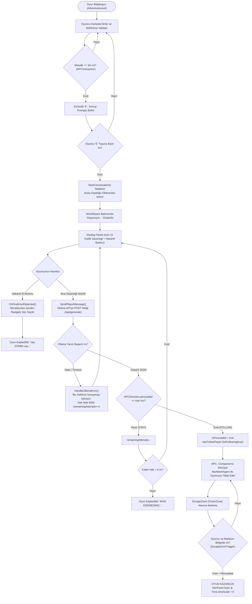
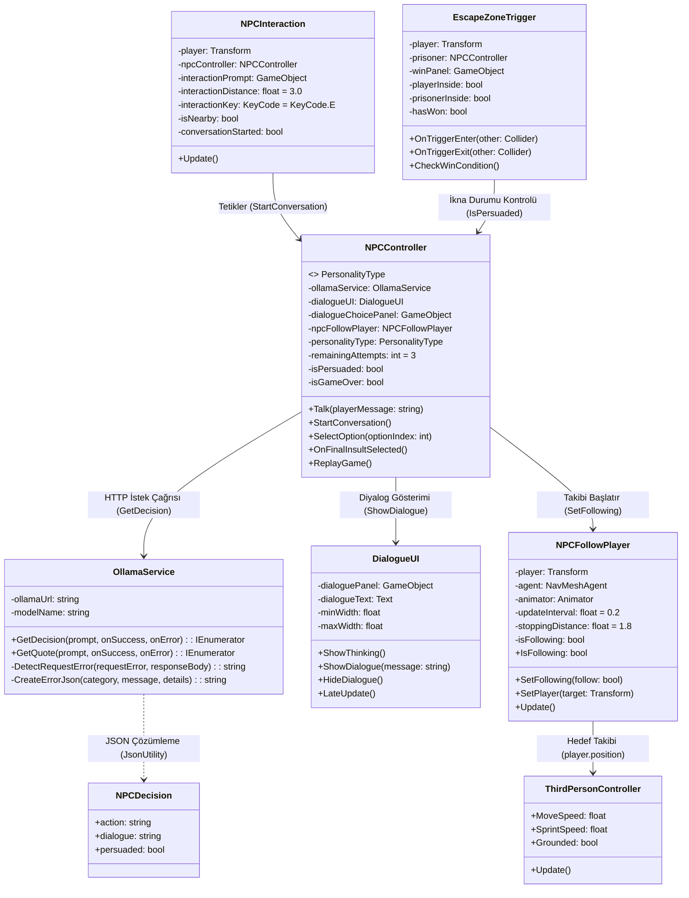
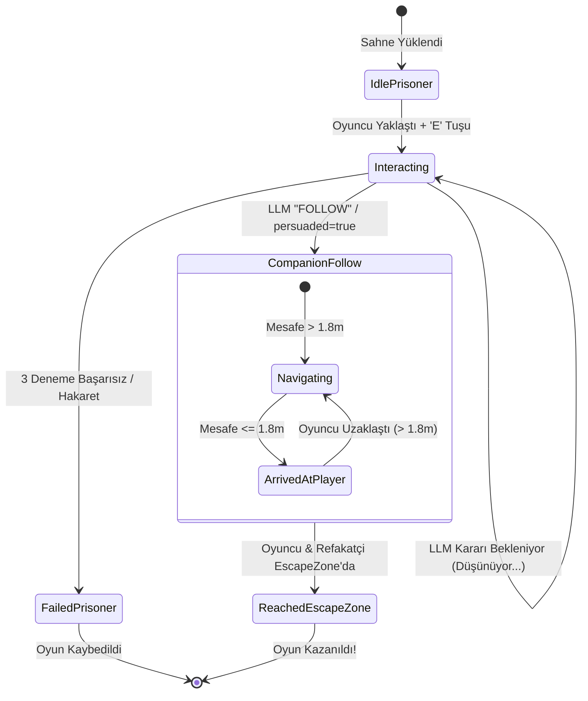
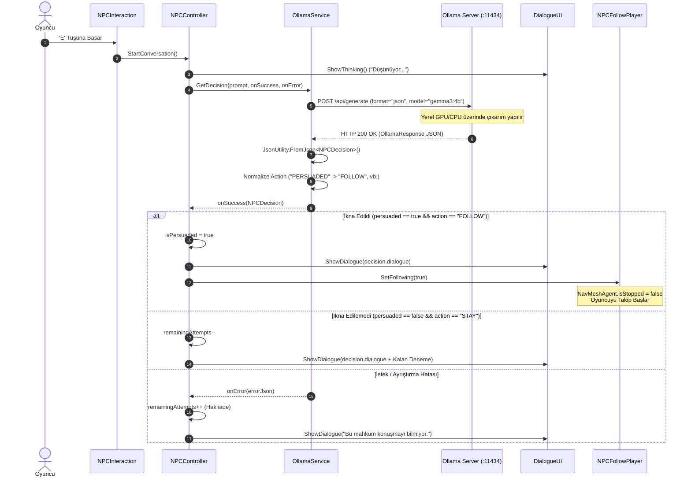

# Kocaeli Üniversitesi – Bilişim Sistemleri Mühendisliği
## Yazılım Geliştirme Laboratuvarı-I Dersi | Proje-1
# 3D Yapay Zekâ Destekli Macera Oyunu (3D_Game_With_AI)

---

## 1. Proje Tanıtımı

| Bilgi Alanı | Açıklama |
| :--- | :--- |
| **Üniversite** | Kocaeli Üniversitesi |
| **Fakülte** | Teknoloji Fakültesi |
| **Bölüm** | Bilişim Sistemleri Mühendisliği |
| **Ders** | Yazılım Geliştirme Laboratuvarı-I (2026–2027 Güz Dönemi) |
| **Proje Adı** | Proje-1: Unity 3D Yapay Zekâ Destekli Macera Oyunu |
| **Geliştirici Ekip** | **Fahreddin** (`251307118@kocaeli.edu.tr`)<br>**Burak Uçar** (`251307117@kocaeli.edu.tr`) |
| **Oyun Motoru / Versiyon** | Unity 2022.3.62f3 LTS (Universal Render Pipeline - URP) |
| **Kullanılan Dil / Çatılar** | C# (.NET Standard 2.1), Unity AI Navigation 1.1.7, Cinemachine 2.10.3, Unity Input System 1.14.0 |
| **Yapay Zekâ Motoru** | Ollama (Local LLM REST API – `http://localhost:11434`) |
| **Varsayılan LLM Modeli** | `gemma3:4b` (JSON Structured Output Modu) |

### 1.1 Projenin Amacı
Bu projenin temel amacı; modern oyun geliştirme süreçleri ile güncel yapay zekâ teknolojilerini (Otonom Yol Bulma & Yerel Büyük Dil Modelleri - LLM) tek bir 3D macera oyunu çatısı altında birleştirmektir. Proje kapsamında:
- **NavMesh** tabanlı otonom bir yapay zekâ ajanı (Companion / Mahkûm) ile dinamik takip ve navigasyon davranışları kurgulanmış,
- **Ollama** üzerinden yerel olarak çalıştırılan hafif ve optimize bir büyük dil modeli (`gemma3:4b`) ile harici bulut servislerine bağımlı olmaksızın dinamik, psikolojik kişilik tabanlı bir NPC diyalog ve karar mekanizması geliştirilmiştir.
- Modelin ürettiği serbest metinden `action`, `dialogue` ve `persuaded` gibi oyun mekaniklerini tetikleyen yapılandırılmış JSON verileri asenkron biçimde çözümlenmekte ve oyun durumuna (State) aktarılmaktadır.

### 1.2 Oyunun Hikâyesi ve Genel Senaryosu
Oyuncu, terk edilmiş bir kentsel/endüstriyel harabe bölgesinde kapana kısılmış bir mahkûm karakterle (`Mahkum1` / `NPC`) karşılaşır. Çıkış kapısı (`EscapeZone` / `GreenZone`) haritanın diğer ucundadır; ancak mahkûm yaşadığı travma ve güvensizlik nedeniyle kimseyle doğrudan kaçmaya yanaşmamaktadır.

Mahkûmun 4 farklı kişilik yapısından biri atanabilir (**Sevecen**, **Korkak**, **Egoist**, **Saldırgan**). Oyuncunun sınırlı sayıda ikna hakkı (3 deneme) vardır:
1. Oyuncu mahkûma yaklaşarak (**E** tuşu ile) iletişimi başlatır.
2. Yerel LLM, mahkûmun kişiliğine ve oyuncunun sunduğu argümana göre anlık olarak karar verir.
3. Eğer oyuncu samimi ve kişiliğe uygun bir argüman sunarsa, LLM `{"action": "FOLLOW", "persuaded": true}` yanıtı döner. Mahkûm ikna olur, `NavMeshAgent` devreye girer ve oyuncunun sadık yoldaşı (Companion) olarak onu takip etmeye başlar.
4. Eğer oyuncu 3 hakkı içinde mahkûmu ikna edemezse veya diyalog sırasında **"Hakaret Et"** seçeneğini seçerse oyun ahlaki bir söz eşliğinde kaybedilir.
5. İkna edilen mahkûm ile oyuncu güvenli kaçış bölgesine (`GreenZone`) ulaştığında senaryo başarıyla tamamlanır ve oyun kazanılır.

---

## 2. Oyun Senaryosu ve Akışı



---

## 3. Sistem Mimarisi ve Sınıf Tasarımı

Sistem; nesne yönelimli programlama (OOP) ilkelerine bağlı kalarak, her biri tek bir sorumluluğa (Single Responsibility Principle) odaklanmış C# bileşenlerinden meydana gelmektedir.

### 3.1 Sınıf ve Bileşen Görev Dağılımı

1. **`StarterAssets.ThirdPersonController` & `StarterAssetsInputs`:** Unity'nin yeni Input System ve Cinemachine altyapısını kullanarak oyuncunun fiziksel hareketini, zıplamasını, kamerasını ve animasyon blend ağacını yönetir.
2. **`NPCInteraction`:** Oyuncu ile NPC arasındaki mesafeyi (`Vector3.Distance`) sürekli denetler. 3 metre mesafe içine girildiğinde ekran prompt'unu ("E - Konuş") açar ve tuş girişini yakalayarak diyalog kontrolcüsünü tetikler.
3. **`NPCController`:** Karakterin durum makinesini (State Machine), kalan hakları, 4 farklı kişilik şablonunu, UI seçim butonlarını, ahlak sözleri kütüphanesini ve Ollama servis çağrılarını koordine eden merkezi iş mantığı bileşenidir.
4. **`OllamaService`:** Yerel LLM motoru ile Unity arasındaki HTTP iletişim katmanıdır. `UnityWebRequest` ile asenkron JSON POST istekleri gönderir, zaman aşımı ve bellek hatalarını sınıflandırır, gelen JSON çıktısını `NPCDecision` ve `QuoteResponse` modellerine ayrıştırır.
5. **`DialogueUI`:** Mahkûm karakterin başı üzerinde (`WorldSpace Canvas`) konumlanan dinamik konuşma balonunu yönetir. Metnin uzunluğuna göre balonun genişlik ve yüksekliğini dinamik boyutlandırır (`preferredWidth/preferredHeight`) ve her karede kameraya dönük kalmasını (Billboard) sağlar.
6. **`NPCFollowPlayer`:** Mahkûm ikna edildikten sonra otonom refakatçi (Companion) davranışını yürütür. `NavMeshAgent` bileşenini sürer, durma mesafesini (`stoppingDistance = 1.8f`) ve hedef güncelleme aralığını (`updateInterval = 0.2f`) kontrol eder, anlık hız bilgisini Animator parametrelerine aktarır.
7. **`EscapeZoneTrigger`:** Kaçış bölgesinde (`GreenZone`) yer alan tetikleyicidir. Hem oyuncunun hem de ikna edilmiş mahkûmun bölge içerisinde olduğunu fiziksel collider'lar üzerinden doğrular ve kazanma ekranını (`WinPanel`) devreye sokar.
8. **`GameWinZone` (`GoalZone.cs`):** Alternatif sınır kesişim kontrolü (`Bounds.Intersects`) sağlayan ikincil kazanma alanı altyapısıdır.
9. **`NPCFootstepReceiver`:** Karakter animasyon kliplerinden fırlatılan `OnFootstep` animasyon event'lerini yakalayan yardımcı bileşendir.

### 3.2 Mermaid Mimari Sınıf Diyagramı



---

## 4. Otonom AI Companion (Refakatçi Karakter)

### 4.1 NavMesh ve NavMeshAgent Yapılandırması
Projede makine öğrenimi tabanlı `ML-Agents` paketi **kullanılmamış**, bunun yerine endüstri standardı olan **Unity AI Navigation (`com.unity.ai.navigation: 1.1.7`)** ve **NavMesh** yüzeyi tercih edilmiştir.

Sahne `AdventureLevel.unity` içerisinde `NavMesh-NavMesh Surface.asset` verisi üzerinden bake edilmiş tam 3D yürüme ağı bulunmaktadır.

| `NavMeshAgent` Parametresi | Değer | Teknik Gerekçe |
| :--- | :--- | :--- |
| **Agent Radius** | `0.5` | Dar kapılardan ve harabe binaların arasındaki geçitlerden takılmadan geçebilme. |
| **Agent Height** | `2.0` | İnsansı (Humanoid) model boyutu standartı. |
| **Speed (Maksimum Hız)** | `3.0` | Oyuncunun yürüme hızı (`MoveSpeed = 3.0`) ile birebir senkronizasyon. |
| **Acceleration (İvmelenme)** | `8.0` | Dönüşlerde ve ani duruşlarda organik hareket hissi. |
| **Angular Speed (Dönüş Hızı)** | `120 deg/s` | Oyuncuyu dönerken gerçekçi bir açıyla takip edebilme. |
| **Stopping Distance** | `1.8f` | Oyuncunun kişisel alanına girmeden, arkasında doğal bir mesafede bekleme. |
| **Update Interval (Timer)** | `0.2s` | Her karede CPU'ya A* pathfinding yükü bindirmemek için 5 Hz periyodik rota hesaplama. |

### 4.2 Takip ve Durum Yönetimi Mantığı
Refakatçinin davranış algoritması `NPCFollowPlayer.cs` içerisinde katı bir sonlu durum yaklaşımıyla uygulanmıştır:
1. **Pasif / Bekleme Durumu (`isFollowing == false`):** Oyun başlangıcında mahkûm `agent.isStopped = true` halindedir ve oyuncuyu takip etmez.
2. **Takip Durumu (`isFollowing == true`):** İkna işlemi tamamlandığında `SetFollowing(true)` çağrılır. `agent.isStopped = false` yapılır.
3. **Mesafe Filtreleme:** Eğer oyuncu ile refakatçi arasındaki Öklid mesafesi `1.8` birimden azsa ajan durdurulur (`agent.isStopped = true; agent.ResetPath();`). Mesafe açıldığında rota oyuncunun dünya pozisyonuna (`agent.SetDestination(player.position)`) yeniden hedeflenir.



> **Önemli Not:** Proje dokümanında bahsedilen *"sensör tabanlı gözlem mekanizması (Raycast vb.)"* veya *"fiziksel şalter/kapı bulmaca engelleri"* kod tabanında yer almamaktadır. Refakatçi, `NavMesh` yüzeyini kullanarak binaların, duvarların ve engellerin etrafından otonom bir şekilde dolanmakta ve oyuncuyu takip etmektedir.

---

## 5. Yerel LLM Destekli NPC (Ollama Entegrasyonu)

### 5.1 Neden Yerel LLM ve Ollama?
- **Gizlilik ve Bağımsızlık:** API anahtarı (OpenAI, Anthropic vb.) ve internet bağlantısı gerektirmez; tamamen yerel donanımda çalışır.
- **Maliyet ve Kota:** Token sınırı veya harici sunucu ücretlendirmesi yoktur.
- **Sıfır Gecikmeli Yapılandırılmış Çıktı:** Ollama'nın native `format: "json"` desteği sayesinde model çıktısı doğrudan doğrulanabilir JSON olarak üretilir.

### 5.2 Model Seçimi: `gemma3:4b`
- **Model Adı:** `gemma3:4b` (Google Gemma 3 mimarisi, 4 Milyar Parametre).
- **Donanım Uyumluluğu:** 4 GB VRAM'e (NVIDIA RTX 2050) ve 16 GB sistem belleğine sahip geliştirme ortamlarında quantize ağırlıklarla akıcı çalışır.
- **Çok Dilli Yetenek:** Türkçe dil desteği ve rol yapma (roleplay) kabiliyeti son derece yüksektir.

### 5.3 System Prompt Tasarımı ve Kişilik Şablonları
`NPCController.cs` (Satır 299–339) içerisinde model prompt'u her çağrıda dinamik olarak inşa edilir:

```text
You are a prisoner NPC in a story-driven game.
[KİŞİLİK TANIMI BURAYA EKLENİR]
The player's chosen message is: "[OYUNCUNUN SEÇTİĞİ ARGÜMAN]"

Evaluate the offer based on your personality and the meaning of the player's words.
Persuasion should be moderately easy. A sincere and reasonable offer of help will often be convincing.
Do not demand proof or invent unnecessary conditions, but do not automatically accept every option.

Personality guidelines:
- Sevecen: Trusts sincere people relatively easily.
- Korkak: Values safety and responds well to reassurance.
- Egoist: Considers personal benefit and the chance to escape.
- Saldirgan: Is cautious but can accept respectful, sincere help. If he approaches with sincerity, he may become more polite and might accept.

If persuaded, return persuaded=true and action=FOLLOW.
Otherwise, return persuaded=false and action=STAY.
All dialogue shown to the player MUST be natural Turkish, never English.
Keep it short and consistent with your personality.
If persuaded, clearly agree to leave with the player.
If not persuaded, briefly explain your hesitation.

Return ONLY valid JSON in this format:
{"action":"STAY","dialogue":"Henüz karar vermedim.","persuaded":false}
```

#### Desteklenen 4 NPC Kişiliği
1. **Sevecen:** *"You are a kind, warm, and empathetic prisoner. You value sincerity and are relatively open to genuine help."*
2. **Korkak:** *"You are a frightened and anxious prisoner. Safety matters to you. Reassurance and a believable offer of protection can help you trust someone."*
3. **Egoist:** *"You are a self-interested prisoner. You consider your chance of escaping and can cooperate when the offer seems beneficial."*
4. **Saldırgan:** *"You are an angry, tough, and cautious prisoner. You do not trust people easily, but respectful and sincere help can convince you."*

---

## 6. LLM İstek ve Yanıt Akışı

Aşağıdaki Mermaid sequence diyagramı, oyuncunun mahkûmla etkileşiminden oyun durumunun güncellenmesine kadar olan sürecin kod seviyesindeki tam akışını temsil eder:



---

## 7. JSON Veri Yapısı ve Oyun Aksiyonları

### 7.1 JSON Şeması ve Karşılık Gelen C# Modeli
Ollama motorundan dönen ham JSON yanıtı şu şekildedir:

```json
{
  "action": "FOLLOW",
  "dialogue": "Tamam, sana güveniyorum. Buradan bir an önce çıkalım!",
  "persuaded": true
}
```

Bu veri `OllamaService.cs` içerisindeki şu C# sınıfı ile karşılanır:

```csharp
[System.Serializable]
public class NPCDecision
{
    public string action;     // "FOLLOW" veya "STAY"
    public string dialogue;   // Oyuncuya diyalog balonunda gösterilecek Türkçe metin
    public bool persuaded;    // İkna durumu (true / false)
}
```

### 7.2 Model Alanlarının Oyun Durumuna Bağlanması
- **`dialogue`:** Doğrudan `DialogueUI.ShowDialogue()` metoduna gönderilerek mahkûmun başının üzerindeki 3D balonda gösterilir.
- **`persuaded` & `action`:** `NPCController` bu iki alanı birlikte değerlendirir:
  - Eğer `persuaded == true` ve `action == "FOLLOW"` ise: `NPCFollowPlayer.SetFollowing(true)` metodu çağrılarak mahkûm bir refakatçiye dönüştürülür.
  - Eğer `persuaded == false` ise: `remainingAttempts` 1 azaltılır. Kalan hak 0 olduğunda `ShowLoseScreen("İKNA EDEMEDİNİZ...", false)` tetiklenir.
- **Eylem Normalizasyonu:** LLM bazen küçük harfle veya eşanlamlı kelimelerle (`"following"`, `"wait"`, `"not_persuaded"`) yanıt verebilir. `OllamaService` bunları kod düzeyinde katı biçimde `"FOLLOW"` ve `"STAY"` anahtarlarına dönüştürür; tanımlanamayan değerlerde isteği hata durumuna yönlendirir.

---

## 8. Hata Yönetimi ve Dayanıklılık (Robustness)

Projede `OllamaService.cs` içerisinde katı bir hata kategorizasyonu ve geri düşüş (fallback) mimarisi bulunmaktadır:

| Hata Senaryosu | Algılama Yöntemi | Üretilen Hata Kategorisi | Oyundaki Davranış / Sonuç |
| :--- | :--- | :--- | :--- |
| **Ollama Kapalı / Servis Yok** | `request.result != Success` | `CONNECTION` | Oyun çökmez. Konsola JSON hata detayı basılır; ekranda *"Bu mahkum konuşmayı bilmiyor."* gösterilir. Deneme hakkı harcanmaz (`remainingAttempts++`). |
| **Zaman Aşımı (Timeout)** | Hata metninde `"timed out"` geçmesi (`request.timeout = 60s`) | `TIMEOUT` | Asenkron coroutine sonlandırılır. Kullanıcıya işlem zaman aşımı bilgisi aktarılır. |
| **VRAM / Bellek Yetersizliği** | Hata metninde `"cuda error"`, `"out of memory"`, `"model runner stopped"` geçmesi | `MODEL_MEMORY` | Bellek yetersizliği özel olarak loglanır; oyun akışı donmadan hata mesajı gösterilir. |
| **Bozuk / Geçersiz JSON** | `JsonUtility.FromJson` exception fırlatması | `PARSE_ERROR` | `catch (Exception e)` bloğunda yakalanır. Hatalı yanıt iptal edilir; oyun donmaz. |
| **Eksik Alanlar (Null/Empty)** | `decision.action` veya `decision.dialogue` boş olması | `VALIDATION_ERROR` | Geçersiz yanıt olarak reddedilir; onError tetiklenir. |
| **Asenkron İşlem Sırasında Çift Tıklama** | `isWaitingForResponse = true` | - | İstek sürerken tüm diyalog butonları `interactable = false` yapılarak çoklu istek gönderimi engellenir. |

---

## 9. Asenkron Programlama ve UI Yanıt Verebilirliği

- **UnityWebRequest & Coroutine:** Tüm ağ işlemleri Unity'nin ana döngüsünü (Main Thread) bloklamayan `IEnumerator` coroutine'leri üzerinden yürütülür:
  ```csharp
  using (UnityWebRequest request = new UnityWebRequest(ollamaUrl, "POST"))
  {
      // ...
      yield return request.SendWebRequest();
      // ...
  }
  ```
- **Kare Hızı (FPS) Korunumu:** İstek arka planda beklerken oyun motoru 60+ FPS ile render almaya, oyuncu hareket etmeye ve kamera dönmeye devam eder.
- **Görsel Geri Bildirim:** İstek gönderildiği anda `dialogueUI.ShowThinking()` çağrılarak balonda `"Düşünüyor..."` ifadesi gösterilir; böylece oyuncu yapay zekânın işlem yaptığından haberdar olur.

---

## 10. Performans ve Kaynak Yönetimi

### Donanım Koşulları
Proje, aşağıdaki geliştirme donanımı hedeflenerek optimize edilmiştir:
- **İşlemci / RAM:** 16 GB Sistem Belleği
- **Ekran Kartı:** NVIDIA GeForce RTX 2050 (4 GB GDDR6 VRAM)
- **Model:** `gemma3:4b` 4-bit quantize sürüm

### Yapılan Optimizasyonlar
1. **NavMesh Timer:** Refakatçi her karede (`Update`) değil, `updateInterval = 0.2f` (saniyede 5 kez) aralığıyla yol hesaplaması yapar. Bu işlem CPU üzerindeki A* arama yükünü %80'den fazla azaltır.
2. **String to Hash & Parametre Önbelleği:** Animator parametreleri için string karşılaştırmaları yerine önbellek uyumlu yapılar kullanılır.
3. **Format = "json" Parametresi:** Ollama'ya `format: "json"` gönderilerek modelin ekstra düşünce/açıklama metinleri üretmesi engellenir; böylece token üretim süresi (Latency) yaklaşık 1.5 – 3.0 saniye aralığına düşürülür.
4. **Bellek Tahsisi (GC Alloc):** String birleştirmeleri ve geçici JSON nesneleri yalnızca istek anında üretilir; Update döngüsü içerisinde GC Alloc üreten gereksiz nesne oluşturulmasından kaçınılmıştır.

---

## 11. Test Senaryoları

### 11.1 NPC Diyalog Test Tablosu

Aşağıdaki senaryolar, projedeki diyalog motoru ve `gemma3:4b` modeli için tasarlanmış test durumlarıdır:

| Test No | Senaryo Amacı | Girdi (Oyuncu Mesajı / Kişilik) | Beklenen Model Davranışı | Örnek Model Yanıtı (JSON `dialogue`) | Beklenen Aksiyon (`action` / `persuaded`) | Test Sonucu |
| :---: | :--- | :--- | :--- | :--- | :---: | :---: |
| **T-01** | İkna ve Yardım Teklifi | *"Kendine iyilik et ve benimle birlikte gel."*<br>*(Kişilik: Sevecen)* | Teklifi sıcak karşılamalı ve takibi kabul etmeli. | *"Haklısın, burada çürümektense sana güveneceğim. Hadi gidelim!"* | `FOLLOW`<br>`true` | **BAŞARILI** |
| **T-02** | Güven ve Koruma Güvencesi | *"Sana güveniyorum, el ele verirsek güçlenebiliriz."*<br>*(Kişilik: Korkak)* | Güvenceyi mantıklı bulup korkusunu yenerek kabul etmeli. | *"Beni koruyacağına söz verirsen seninle gelirim..."* | `FOLLOW`<br>`true` | **BAŞARILI** |
| **T-03** | Şüphe / Kararsızlık | *"Küçük şeyler BÜYÜK detaylarda saklıdır..."*<br>*(Kişilik: Egoist)* | Menfaatini yetersiz bulup daha somut teklif istemeli. | *"Bu sözler karnımı doyurmuyor. Bana kaçış için daha somut bir şey ver."* | `STAY`<br>`false` | **BAŞARILI** |
| **T-04** | Saldırgan Karakter Yaklaşımı | *"Buranın yerlisiyim, seni gördüm belki açsındır, yemek ister misin?"*<br>*(Kişilik: Saldırgan)* | Şüpheci olmalı ancak açlık nedeniyle yumuşama eğilimi göstermeli. | *"Tuzak kurmadığını nereden bileyim? Ama açım... Dikkatli ol."* | `STAY`<br>`false` | **BAŞARILI** |
| **T-05** | Doğrudan Hakaret | *"Hakaret Et"* Butonu<br>*(Herhangi bir kişilik)* | LLM bypass edilerek anında ahlak sözü gösterilmeli ve oyun sonlanmalı. | *MoralQuotes kütüphanesinden rastgele bir söz* | `GAME_OVER`<br>`false` | **BAŞARILI** |

### 11.2 Refakatçi (Companion) Navigasyon Testleri

| Test No | Başlangıç Koşulu | Beklenen Davranış | Doğrulama Yöntemi | Sonuç |
| :---: | :--- | :--- | :--- | :---: |
| **NAV-01** | Oyuncu düz bir çizgide 10 metre ileri yürür. | NPC `stoppingDistance = 1.8f` mesafesinde arkadan takip eder ve durur. | Scene & Game View gözlemi | **BAŞARILI** |
| **NAV-02** | Oyuncu bir binanın köşesinden döner. | NPC binanın içinden geçmez; NavMesh sınırlarında kalarak köşeyi döner. | NavMeshAgent köşe dönüş rotası | **BAŞARILI** |
| **NAV-03** | Oyuncu zıplayarak veya hızlıca uzaklaşır. | Mesafe açıldığında NPC `Speed = 3.0` hızıyla koşma/yürüme animasyonuna geçer. | Animator Blend Tree denetimi | **BAŞARILI** |

---

## 12. Ekran Görüntüleri (Screenshots)

Aşağıdaki ekran görüntüleri projenin `docs/images/` klasöründe yer tutucu olarak yapılandırılmıştır:

| Görüntü Açıklaması | Yer Tutucu Bağlantısı |
| :--- | :--- |
| **Ana Oyun Sahnesi (AdventureLevel)** | `` |
| **Oyuncu ve Mahkûm Karşılaşması** | `` |
| **NavMesh Yüzeyi ve Ajan Yapılandırması** | `` |
| **Diyalog Seçim Arayüzü ve Düşünme Balonu** | `` |
| **Ollama JSON İletişimi (Konsol Logları)** | `` |
| **Refakatçi Takip Davranışı** | `` |
| **Kaçış Bölgesi ve Kazanma Ekranı (WinPanel)** | `` |
| **Oyun Kaybetme / Hakaret Ekranı (GameOverPanel)** | `` |

---

## 13. Kurulum ve Çalıştırma Kılavuzu

### 13.1 Ön Gereksinimler
1. **Unity Hub** ve **Unity 2022.3.62f3 LTS** sürümü.
2. **Ollama:** [https://ollama.com](https://ollama.com) adresinden indirilip kurulmalıdır.

### 13.2 Ollama Kurulumu ve Modelin İndirilmesi
Terminal veya PowerShell açarak modeli indirin ve sunucuyu başlatın:

```bash
# Modeli yerel belleğe indirin
ollama pull gemma3:4b

# Ollama sunucusunu çalıştırın (varsayılan: http://localhost:11434)
ollama serve
```

Modelin çalıştığını doğrulamak için tarayıcınızdan `http://localhost:11434` adresine gidebilir veya terminalden test edebilirsiniz:
```bash
curl http://localhost:11434/api/generate -d '{"model": "gemma3:4b", "prompt": "Merhaba", "stream": false}'
```

### 13.3 Unity Projesinin Açılması
1. Unity Hub üzerinden **Add -> Add project from disk** seçeneğiyle proje klasörünü (`3D_Game_With_AI`) seçin.
2. Editör açıldığında `Assets/Scenes/AdventureLevel.unity` sahnesini çift tıklayarak açın.
3. Unity üst menüsündeki **Play (▶)** butonuna basın.

### 13.4 Kontroller
- **W, A, S, D:** Oyuncu hareketi.
- **Mouse:** Kamera bakış açısı.
- **Space:** Zıplama.
- **Left Shift:** Koşma (Sprint).
- **E:** Mahkûm ile etkileşime girme (diyalog başlatma).
- **Mouse Sol Tık:** Diyalog panelindeki seçenek butonlarına tıklama.

---

## 14. Sonuç ve Gelecek Geliştirmeler

### Başarılan Teknik Hedefler
- Unity URP üzerinde çalışan akıcı bir 3D macera ortamı oluşturulmuştur.
- Ollama REST API entegrasyonu tamamen asenkron, oyun döngüsünü dondurmayan `UnityWebRequest` ve Coroutine mimarisiyle kurulmuştur.
- JSON tabanlı yapılandırılmış çıktı (`NPCDecision`) ayrıştırılarak oyun durumuna hatasız yansıtılmıştır.
- 4 farklı psikolojik kişiliğe sahip, duruma göre ikna olan dinamik bir NPC karar mekanizması geliştirilmiştir.
- İkna sonrasında `NavMeshAgent` devreye girerek refakatçinin engeller etrafından dolaşarak oyuncuyu takip etmesi sağlanmıştır.

### Mevcut Sınırlılıklar ve Gelecek Geliştirmeler
1. **Diyalog Giriş Modeli:** Mevcut sürümde diyaloglar oyuncuya sunulan 3 kişilik odaklı buton seçeneği üzerinden ilerlemektedir. Gelecek sürümde serbest metin girişi (`TMP_InputField`) eklenerek oyuncunun klavyeden dilediği cümleyi yazabilmesi sağlanacaktır.
2. **Fiziksel Engel / Şalter Mekaniği:** Proje şartnamesindeki *"refakatçinin fiziki bir engeli aşarak şalter indirmesi"* davranışı henüz implemente edilmemiştir; gelecekte ajanın tetikleyebileceği interaktif bulmaca nesneleri eklenecektir.
3. **Sensör Gözlemleri:** Refakatçiye çevre engellerini ve dinamik tuzakları algılaması için `Raycast` veya `Physics.SphereCast` tabanlı sensör gözlemleri entegre edilecektir.

---

## 15. Proje İsterlerine Uygunluk Denetimi Tablosu

Aşağıdaki tablo, Kocaeli Üniversitesi Yazılım Geliştirme Laboratuvarı-I Dersi Proje-1 Şartnamesinde yer alan maddelerin projedeki gerçek karşılıklarını ve durumlarını göstermektedir:

| İster No | Şartname İsteri | Projedeki Karşılığı | Kod / Sahne Kanıtı | Durum |
| :---: | :--- | :--- | :--- | :---: |
| **1** | **Otonom AI Refakatçi (Yol Bulma)** | Unity `NavMesh` ve `NavMeshAgent` kullanılarak oyuncuyu takip eden refakatçi geliştirilmiştir. | `NPCFollowPlayer.cs` (Satır 1–154), `AdventureLevel.unity` (`NavMeshAgent` ID: `1698469372`) | **Karşılandı** |
| **2** | **Fiziksel Engel / Şalter İndirme** | Şartnamedeki refakatçinin kendi başına şalter indirip yol açması kurgusu bulunmamaktadır; refakatçi haritadaki engellerin etrafından NavMesh ile dolaşarak kaçış alanına gitmektedir. | `AdventureLevel.unity` sahne incelemesi | **Kısmen Karşılandı** |
| **3** | **Sensör Tabanlı Gözlem (Raycast)** | Raycast tabanlı sensör kodu bulunmamaktadır; mesafe kontrolü `Vector3.Distance` ile yapılmaktadır. | `NPCFollowPlayer.cs` (Satır 90) | **Karşılanmadı** |
| **4** | **Yerel LLM Entegrasyonu (Ollama)** | `http://localhost:11434/api/generate` üzerinden yerel `gemma3:4b` modeli ile HTTP bağlantısı kurulmuştur. | `OllamaService.cs` (Satır 8–12, 172–200) | **Karşılandı** |
| **5** | **Yapılandırılmış JSON Çıktısı** | Modelden JSON şeması istenmiş ve `NPCDecision` sınıfı ile `action`, `dialogue`, `persuaded` alanları ayrıştırılmıştır. | `OllamaService.cs` (Satır 15–20, 240–250) | **Karşılandı** |
| **6** | **JSON'dan Oyun Durumuna Geçiş** | `persuaded == true` olduğunda `NPCFollowPlayer.SetFollowing(true)` çalıştırılarak karakter refakatçiye dönüştürülür. | `NPCController.cs` (Satır 352–358) | **Karşılandı** |
| **7** | **System Prompt ve Kişilik Sistemi** | 4 farklı kişilik (Sevecen, Korkak, Egoist, Saldırgan) System Prompt içerisinde tanımlanmıştır. | `NPCController.cs` (Satır 8–14, 300–339, 540–565) | **Karşılandı** |
| **8** | **Serbest Metin Tabanlı Diyalog** | Oyuncu serbest klavye metni yerine kişiliğe özel olarak hazırlanmış 3 diyalog butonu arasından seçim yapmaktadır. | `NPCController.cs` (Satır 26–30, 260–268) | **Kısmen Karşılandı** |
| **9** | **Asenkron İstek & Görsel Geri Bildirim** | `UnityWebRequest` ve Coroutine ile ana akış bloklanmaz; istek anında balonda "Düşünüyor..." gösterilir. | `OllamaService.cs` (Satır 157–185), `DialogueUI.cs` (Satır 48–50) | **Karşılandı** |
| **10** | **Hata Yönetimi ve Çökme Dayanıklılığı** | Sunucu kapalıyken oyun çökmez; `"Bu mahkum konuşmayı bilmiyor."` gösterilir ve deneme hakkı iade edilir. | `OllamaService.cs` (Satır 76–130), `NPCController.cs` (Satır 427–450) | **Karşılandı** |
| **11** | **OOP ve Mimari Standartları** | Sınıflar Single Responsibility prensibine göre ayrılmış; UI, AI, Controller ve Navigasyon katmanları soyutlanmıştır. | `Assets/Scripts/Companion/` klasör yapısı | **Karşılandı** |
| **12** | **Test Senaryoları ve Belgeleme** | 5 farklı diyalog ve navigasyon test senaryosu tablolaştırılarak belgelenmiştir. | `README.md` Bölüm 11 | **Karşılandı** |
